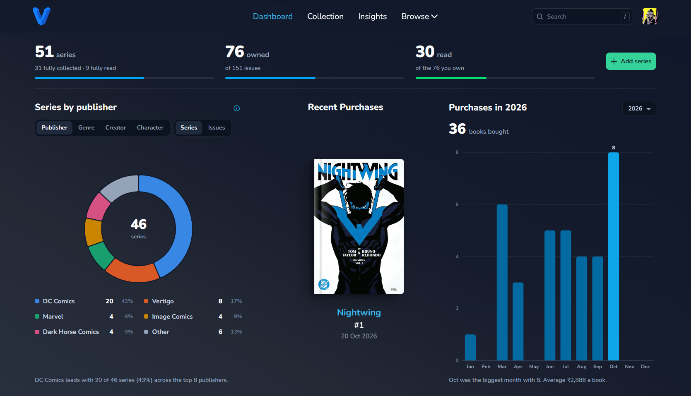
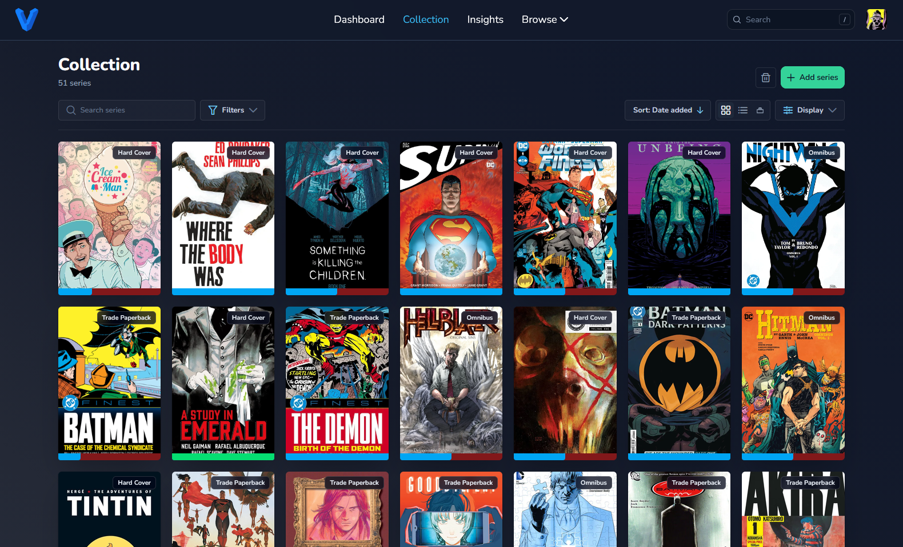
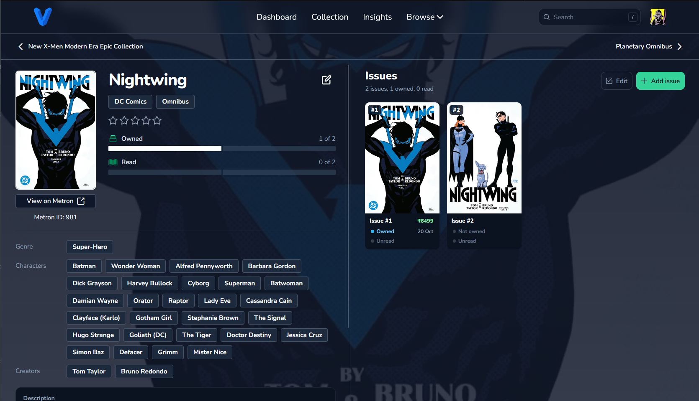

<div align="center">

  
  <h3 align="center">Vertigo</h3>

  <p align="center">
    Vertigo is a self-hosted web app designed to help you catalogue and track your comic book collection with ease. Created using <a href="https://vuejs.org/">Vue.js</a> and <a href="https://flask.palletsprojects.com/en/3.0.x/">Flask</a>
  </p>


  <strong>Live Demo:</strong> https://demo.vertigolabs.dev  
  <strong>Username:</strong> <code>demo</code> 
  Password: <code>demo@2026</code>

</div>


<h3 align="center">Screenshots</h3>

<p align="center">
  
</p>
<p align="center">
  
</p>
<p align="center">
  
</p>

> **⚠ Disclaimer ⚠**: Vertigo is WIP and under active development. Expect occasional bugs, incomplete features, and potential breaking changes as I add new features and improve functionality.

## Goals:

- [x] A responsive modern web app to track and curate physical comicbook collection
- [x] Search and filter options based on various criteria such as title, publisher etc.
- [x] Track reading progress (read/unread, backlog and ratings if needed).
- [x] Generate insightful statistics on collection.
- [x] Export User Data to commonly used formats like spreadsheets.
- [x] Explore options to integrate with external APIs for automatic fetching of details.

Feel free to reach out if you have anything else you'd like to see! Open an [issue](https://github.com/anonhacker47/Vertigo/issues) for bugs and ideas, or email [hello@vertigolabs.dev](mailto:hello@vertigolabs.dev) for anything private.

## Integrations:

Vertigo can fetch series details, covers, creators and characters.

- **Comics** come from [Metron](https://metron.cloud/). You'll need a Metron account and an API token. Paste it in under **Settings > Integrations** and comic search is good to go.

- **Manga** comes from MyAnimeList through [Tenrai](https://tenrai.org/), a public mirror of MAL. Nothing to set up.

<br/>

## Getting Started:

Vertigo has now entered its **Alpha release** stage! It runs as a single Docker container:

```bash
docker run -d --name vertigo -p 6166:6166 -v ./data:/data ghcr.io/anonhacker47/vertigo:latest
```

Or with Compose, using the `docker-compose.yml` in this repository:

```bash
docker compose up -d
```

Open http://localhost:6166.

<br/>

## Developer Guide:

#### Prerequisites:

- Python 3 (https://www.python.org/downloads/)
- Node.js and npm (https://nodejs.org/)

### Clone the repository

```bash
git clone https://github.com/anonhacker47/vertigo-comic-collection -b main
cd vertigo-comic-collection
```

### Setup

Set up a Python 3 virtualenv and install the dependencies on it:

```bash
cd vertigo-backend
python3 -m venv venv
source venv/bin/activate
pip install -r requirements.txt
```

Create the db and run flask app:

```bash
alembic upgrade head
flask run
```

By default, You can try out the app from http://localhost:5000/ .
<br/>
<br/>

> If you want to tinker with the Frontend follow the below instructions.

#### Frontend Setup

Install the dependencies:

```bash
cd vertigo-ui
npm install
```

Run the Vue.js frontend:

```bash
npm run dev
```

Voila! you can find the frontend at http://localhost:5173/

<br/>

## Acknowledgements

- **[Miguel Grinberg Microblog API](https://github.com/miguelgrinberg/microblog-api)**
- **[Metron](https://metron.cloud/)** for the comic database API
- **[Tenrai](https://tenrai.org/)** for the MyAnimeList manga API

